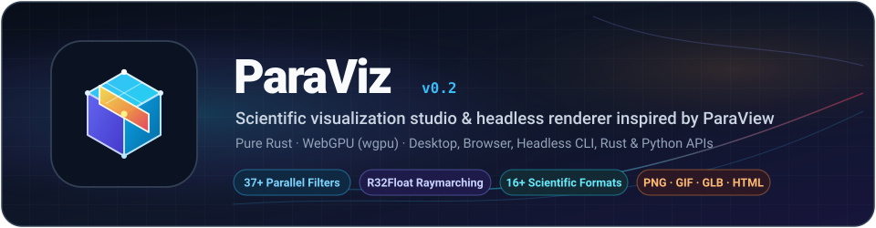
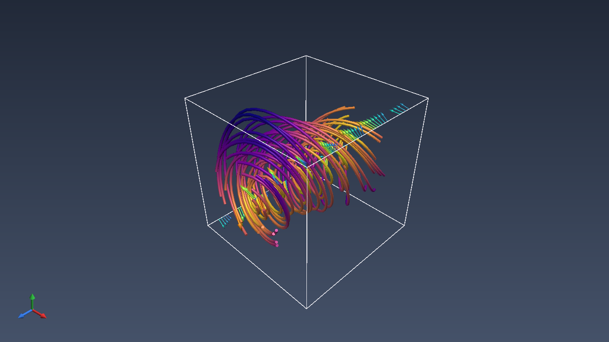
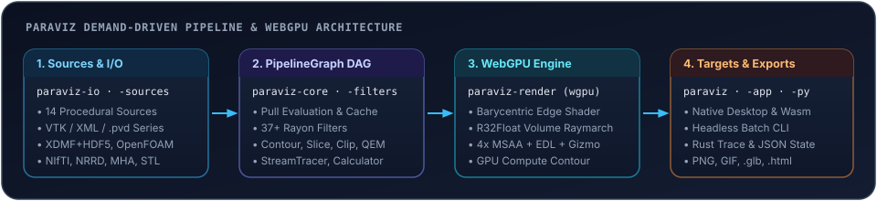

<p align="center">
  
</p>

<p align="center">
  <a href="https://github.com/DimitriTimoz/paraviz/actions/workflows/ci.yml"></a>
  <a href="https://github.com/DimitriTimoz/paraviz/releases"></a>
  <a href="https://dimitritimoz.github.io/paraviz/"></a>
  
  <a href="LICENSE-MIT"></a>
</p>

<p align="center">
  <a href="https://dimitritimoz.github.io/paraviz/"><strong>Try Live Web App</strong></a> ·
  <a href="#install--launch">Install</a> ·
  <a href="#key-capabilities">Capabilities</a> ·
  <a href="#paraviz-vs-classic-paraview">ParaView Comparison</a> ·
  <a href="#headless-cli-quick-start">Headless CLI</a> ·
  <a href="#rust-api-quick-start">Rust API</a> ·
  <a href="docs/README.md">Docs</a> ·
  <a href="https://github.com/DimitriTimoz/paraviz/issues/new/choose">Report Issue</a>
</p>

Explore 3D meshes, CFD flows, finite-element grids, and medical/volumetric scans in an interactive **Desktop Studio** or directly in your browser with the [**Live Web App**](https://dimitritimoz.github.io/paraviz/), automate batch renders from the command line, or embed scientific pipelines in **Rust** and **Python**.

<p align="center">
  
</p>

---

## Install & Launch

### Live Web App (Zero Install)
Launch the WebAssembly + WebGPU build directly in your browser at [**dimitritimoz.github.io/paraviz**](https://dimitritimoz.github.io/paraviz/) (requires a browser with WebGPU or WebGL2 enabled).

### Prebuilt Desktop Releases
Download ready-to-run binaries from [**GitHub Releases**](https://github.com/DimitriTimoz/paraviz/releases):

| Platform | Architectures | Packages |
| --- | --- | --- |
| **Linux** | `x86_64`, `aarch64` | `.AppImage` (portable), `.deb`, `.tar.gz` |
| **macOS** | Universal (`arm64` + `x86_64`) | `.dmg` (`ParaViz.app`), `.tar.gz` |
| **Windows** | `x86_64`, `aarch64` | `.zip` (`paraviz.exe`) |

```bash
# Linux AppImage quick start:
chmod +x ParaViz-*.AppImage
./ParaViz-*.AppImage path/to/dataset.vtu
```

### Build from Source
```bash
cargo run --release -p paraviz-app

# Or open a dataset or saved JSON state directly:
cargo run --release -p paraviz-app -- path/to/mesh.vtu
```

---

## Key Capabilities

<p align="center">
  
</p>

- **Interactive WebGPU Studio**: Real-time `Surface`, `SurfaceWithEdges`, `Wireframe`, `Points` (analytical sphere impostors), `PointGaussian`, `Volume`, and `Outline` representations with **4x MSAA**, **Eye-Dome Lighting (EDL)**, `DarkStudio` / `LightStudio` themes, 11 colormaps, and Camera Bookmarks.
- **Demand-Driven Pipeline & 37+ Parallel Filters**: Pull-evaluated `PipelineGraph` DAG with caching and `rayon` parallelism across isosurfaces (CPU Marching Cubes/Tetrahedra + **GPU Compute Contour**), slices, clips, thresholds, `StreamTracer` & twist-free `TubeFilter`, vector glyphs, Garland-Heckbert QEM decimation, Delaunay 2D/3D, `CalculatorFilter`, line probing, domain integration, and time steps — plus **Auto-Apply** and **Copy/Paste Filter Chains** (`Ctrl/Cmd+C`, `Ctrl/Cmd+V`).
- **3D Volume Raymarching**: Full-precision `R32Float` 3D textures (no optional `float32-filterable` GPU feature required), Interleaved Gradient Noise (IGN) ray jittering, central-difference gradient Phong shading, interactive histogram-backed opacity curves, transfer-function presets, and a live **3D Volume Clip Plane**.
- **Inspection & Quantitative Plots**: 3D raycast picking (`Reveal in Spreadsheet`), 2-point 3D distance ruler, searchable & CSV-exportable attribute spreadsheets, automatic `Plot Over Line` XY charts, and scalar histograms.
- **Broad Scientific Format Support**:
  - **VTK & 3D Meshes**: Legacy `.vtk`, VTK XML (`.vtp`, `.vti`, `.vtu`, `.vtr`, `.vts`, `.vtm`), partitioned `.pvtp`/`.pvti`/`.pvtu`/`.pvtr`/`.pvts`, `.pvd` time series, `.stl`, `.obj`, `.ply`, `.csv`/`.tsv`
  - **Medical & Volumetric**: NIfTI-1 (`.nii`, `.nii.gz`), NRRD (`.nrrd`, `.nhdr`), MetaImage (`.mhd`, `.mha`), Raw binary volumes (`.raw`, `.bin`, `.vol`)
  - **CFD / CAE**: EnSight Gold (`.case`), OpenFOAM (`constant/polyMesh` + fields), XDMF (`.xdmf`, `.xmf` with XML, Binary, and pure-Rust HDF5 `Format="HDF"` + temporal collections)
- **Publication & Portable Web Exports**:
  - High-resolution **PNG** screenshots (with optional **transparent background** & **Scalar Color Bar**)
  - Pure-Rust animated **GIF89a** exports (360° turntables & time series)
  - Binary **glTF 2.0 (`.glb`)** with optional baked colormap vertex colors
  - Self-contained interactive **WebGL2 `.html`** 3D viewers you can share and open in any browser

---

## ParaViz vs. Classic ParaView

ParaViz is a clean-slate Rust + WebGPU (`wgpu`) + `egui` implementation rather than a C++/Qt/OpenGL wrapper around VTK:

| Capability | Classic ParaView (VTK / OpenGL2 / Qt) | ParaViz (Rust / WebGPU / `egui`) |
| --- | --- | --- |
| **`SurfaceWithEdges`** | Polygon-offset / two-pass overlay that can Z-fight at grazing angles | **Single-pass barycentric WGSL shader** with screen-space `fwidth()` anti-aliasing and zero Z-fighting |
| **3D Volume Raymarching** | Hardware 3D texture filtering; slicing banding at coarse steps | **`R32Float` 3D textures** with manual WGSL trilinear filtering, **IGN ray jittering**, and live **3D Volume Clip Plane** |
| **Properties Editing** | Manual **Apply** step before seeing changes | **Auto-Apply** on by default (with explicit **Apply / Discard** toggle for heavy pipelines) |
| **Filter Reuse** | Long-standing feature request (`#21123`) | Built-in **Copy / Paste Filter & Filter Chain** (`Ctrl/Cmd+C` / `Ctrl/Cmd+V`) |
| **Isosurfaces** | CPU Marching Cubes / Contour filters | Parallel `rayon` Marching Cubes with spatial edge-key vertex welding + **WebGPU Compute `GpuContourEngine`** |
| **Streamlines & Tubes** | Frenet-frame tubes (can twist at inflections); `CellData` vector friction | Twist-free **parallel-transport (Bishop) tubes**; automatic `CellData` vector conversion in `StreamTracer` |
| **Scripting & Reproducibility** | Python Trace (`paraview.simple`) + XML `.pvsm` state | Live **Rust Trace** (`to_rust_trace()`), readable **JSON state**, plus standalone `paraviz-py` bindings |
| **Portable Sharing** | Requires external `vtk.js` / Glance tooling for web views | Built-in **GIF89a** turntables, **`.glb`** with baked colors, and standalone **WebGL2 `.html`** viewers |
| **Footprint** | Multi-hundred-MB C++/Qt/Python distribution | Single self-contained native binary or browser WebGPU/Wasm app |

> **Current Scope (`v0.2.x`)**: Focused on single-workstation visualization, batch CLI rendering, and pure-Rust/WebGPU workflows with zero VTK C++ dependency. Distributed MPI / `pvserver`, OSPRay/OptiX path tracing, standalone VTKHDF / raw `.h5` (outside XDMF), CGNS, Exodus II, Silo, CAD B-Rep readers, in-GUI Python scripting, and Catalyst/Ascent co-processing are not in current scope.

See the full comparison and shortcut mapping in [**Differences from Classic ParaView**](docs/differences-from-paraview.md).

---

## Headless CLI Quick Start

Render, inspect, and convert datasets without opening a window:

```bash
# Render a built-in demo scene
cargo run -p paraviz-app -- demo wavelet -o wavelet.png --width 1280 --height 720

# Render a dataset with chained filters, EDL, 4x MSAA, transparent background & color bar
cargo run -p paraviz-app -- render volume.vti -o iso.png \
  --filter contour:140 --repr edges --cmap viridis --color-by RTData \
  --edl --msaa 4 --transparent --scalar-bar

# Export a 360-degree animated GIF turntable
cargo run -p paraviz-app -- render mesh.vtu -o spin.gif --turntable 36 --edl

# Inspect dataset metadata, bounds, and scalar ranges
cargo run -p paraviz-app -- info mesh.vtu

# Convert to binary glTF (.glb) or an interactive WebGL2 (.html) viewer
cargo run -p paraviz-app -- convert mesh.vtu viewer.html
```

---

## Rust API Quick Start

Use `paraviz` as a library in your own Rust project:

```rust
use paraviz::prelude::*;

fn main() -> Result<(), Box<dyn std::error::Error>> {
    let mut pv = ParaViz::new();

    let wav = pv.add_source("Wavelet", WaveletSource::default());
    pv.hide(wav);

    let iso = pv.add_filter(
        "Contour",
        wav,
        ContourFilter::new("RTData", vec![110.0, 175.0]),
    )?;

    pv.show(iso)
        .representation(Representation::SurfaceWithEdges)
        .colormap(ColorMapPreset::Viridis)
        .color_by_point("RTData");

    pv.camera_preset(CameraPreset::Isometric)?;
    pv.render_png("wavelet.png", 1280, 720)?;
    Ok(())
}
```

Run the included examples ([`examples/`](examples/)):
```bash
cargo run --example wavelet_contour
cargo run --example streamlines_and_tubes
cargo run --example volume_raymarch
cargo run --release --example benchmark_pipeline
```

---

## Documentation

Full end-user and developer guides live in the [**Documentation Hub**](docs/README.md):

- [**User Guide**](docs/user-guide.md) — Step-by-step Studio GUI workflows, volume rendering, CFD streamlines, picking, and exports
- [**Differences from Classic ParaView**](docs/differences-from-paraview.md) — UX improvements, shortcut mapping, and feature scope
- [**Desktop Studio GUI & Headless CLI**](docs/gui-and-cli.md) — Complete controls, keyboard/mouse shortcuts (`F1`), and CLI reference
- [**File Formats & I/O**](docs/file-formats.md) — Supported VTK, 3D, medical, and CFD formats & exports
- [**Sources & Filters Reference**](docs/filters-and-sources.md) — All 14 procedural sources, 37+ filters, and `CalculatorFilter` syntax
- [**Rust API Guide (& Python Bindings)**](docs/rust-api.md) — High-level `ParaViz` API, `DataSet` construction, and `paraviz-py`
- [**Architecture & WebGPU Rendering Pipeline**](docs/architecture.md) — Workspace crate breakdown, pipeline DAG, and WGSL shaders

---

## Feedback & Issues

Encountered a bug, rendering glitch, file-loading error, or missing ParaView feature? Please **[open an issue on GitHub](https://github.com/DimitriTimoz/paraviz/issues/new/choose)**.

Including your OS/GPU backend, CLI command (or saved `.json` state / **Rust Trace** output), and steps to reproduce helps us investigate quickly.

---

## Development & Tests

```bash
# Run the full test suite
cargo test --workspace

# Generate local API documentation
cargo doc --workspace --exclude paraviz-app --no-deps --open

# Build a local Linux AppImage
cargo build --release -p paraviz-app
./packaging/linux/build-appimage.sh target/release/paraviz x86_64 ParaViz-x86_64.AppImage
```

---

## Contributing & License

Contributions are welcome! See [CONTRIBUTING.md](CONTRIBUTING.md) and [SECURITY.md](SECURITY.md).

Licensed under either of [Apache License, Version 2.0](LICENSE-APACHE) or [MIT License](LICENSE-MIT) at your option.
