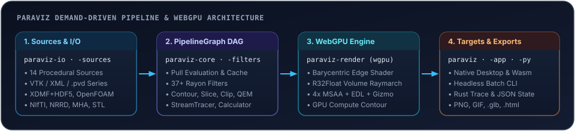

# ParaViz Documentation

Welcome to the **ParaViz** documentation — a fast scientific visualization studio and headless renderer inspired by Kitware ParaView, built in **Rust** and **WebGPU (`wgpu`)**.

<p align="center">
  
</p>

---

## Quick Start by Role

| Role | Where to Start | Key Topics |
| --- | --- | --- |
| **Desktop Analyst** | [**End-User Guide**](user-guide.md) | Studio workspace, Split Views & Linked Cameras, Async loading/Cancel, MultiBlock Inspector, Volume raymarching, Annotations, Exports |
| **Parameter Lookup** | [**Sources & Filters Reference**](filters-and-sources.md) & [**Rendering & Scene Parameters**](rendering-and-scene.md) | Every struct field, Rust type, default value, range, enum variant, and unit across sources, filters, display styles, cameras, and overlays |
| **ParaView User** | [**Differences from Classic ParaView**](differences-from-paraview.md) | UX improvements, shortcut mapping (`1`/`2`/`3`, `R`, `F`, `F1`), and current scope |
| **CLI Batch User** | [**Desktop Studio GUI & Headless CLI**](gui-and-cli.md) | `demo`, `render`, `info`, `convert`, `--filter`, `--transparent`, `--scalar-bar`, `--time-annotation`, `.gif` turntables |
| **Rust API Developer** | [**Rust API Guide (& Python Bindings)**](rust-api.md) | `ParaViz` session API, `PipelineGraph`, `DataSet`, `WebGpuRenderer`, `GpuContourEngine`, and `to_rust_trace()` |
| **Python User** | [**Rust API Guide (& Python Bindings)**](rust-api.md#5-python-bindings-paraviz-py) | Standalone PyO3 `paraviz-py` bindings (`paraviz.Session` modeled after `paraview.simple`) |
| **Contributor** | [**Contributing Guide**](../CONTRIBUTING.md) & [**Architecture**](architecture.md) | Workspace crate breakdown, pipeline DAG, WGSL shaders, and test commands |

---

## Complete Documentation Index

### User Manuals & GUI / CLI Guides
- [**End-User Guide**](user-guide.md) — Detailed Studio GUI manual, MultiBlock patches, Split Views (`1x1`–`2x2`), background async loading, volume raymarching, CFD streamlines, picking/charts, annotations, exports, and performance tuning.
- [**Desktop Studio GUI & Headless CLI**](gui-and-cli.md) — Every menu, toolbar toggle, dock slider range, keyboard shortcut (`F1`), and CLI option.
- [**Differences from Classic ParaView**](differences-from-paraview.md) — Technical comparison, workflow mapping, and out-of-scope subsystems.

### Exhaustive Parameter & Format References
- [**Sources & Filters Parameter Reference**](filters-and-sources.md) — Every parameter, default, constraint, and emitted array for all 14 procedural sources, 37 `FilterConfig` filters, multi-input filters, `GpuContourEngine`, and `CalculatorFilter` syntax.
- [**Rendering, Appearance & Scene Parameters**](rendering-and-scene.md) — Every parameter for `ActorStyle`, `Representation`, `ColorBy`, all 11 colormaps, `TransferFunction`, `Camera`, `SceneSettings`, `ScalarBarConfig`, `ViewportAnnotation`, `ViewportWidget`, and `PickResult`.
- [**File Formats & I/O Reference**](file-formats.md) — All supported readers and writers (`.vtkhdf`, `.cgns`, `.exo`/`.e`/`.ex2`, `.xdmf`, `.case`, `.foam`, VTK/XML/PVD, STL/OBJ/PLY/CSV, NIfTI/NRRD/MetaImage/Raw, `.glb`/`.gif`/`.html`), `DatasetReader`, `RawVolumeDescriptor`, and security bounds.

### Developer & Architecture Docs
- [**Architecture & Rendering Pipeline**](architecture.md) — Workspace crate structure, demand-driven `PipelineGraph`, WebGPU render passes, single-pass `SurfaceWithEdges`, `R32Float` IGN volume raymarching, EDL, and GPU Compute Marching Cubes.
- [**Rust API Guide (& Python Bindings)**](rust-api.md) — Using `ParaViz`, `DisplayHandle`, `PipelineGraph` & `DataSet`, `open_preloaded` / `seed_evaluated`, JSON state persistence, Rust Trace, and `paraviz-py`.

---

## Building API Documentation (Rustdoc)

```bash
cargo doc --workspace --exclude paraviz-app --no-deps --open
```

---

## Encountering an Issue?

If you run into a bug, unexpected error, rendering glitch, or missing capability, please **[open an issue](https://github.com/DimitriTimoz/paraviz/issues/new/choose)** with your OS/GPU details and steps to reproduce (or a **Rust Trace** / `.json` pipeline state).
